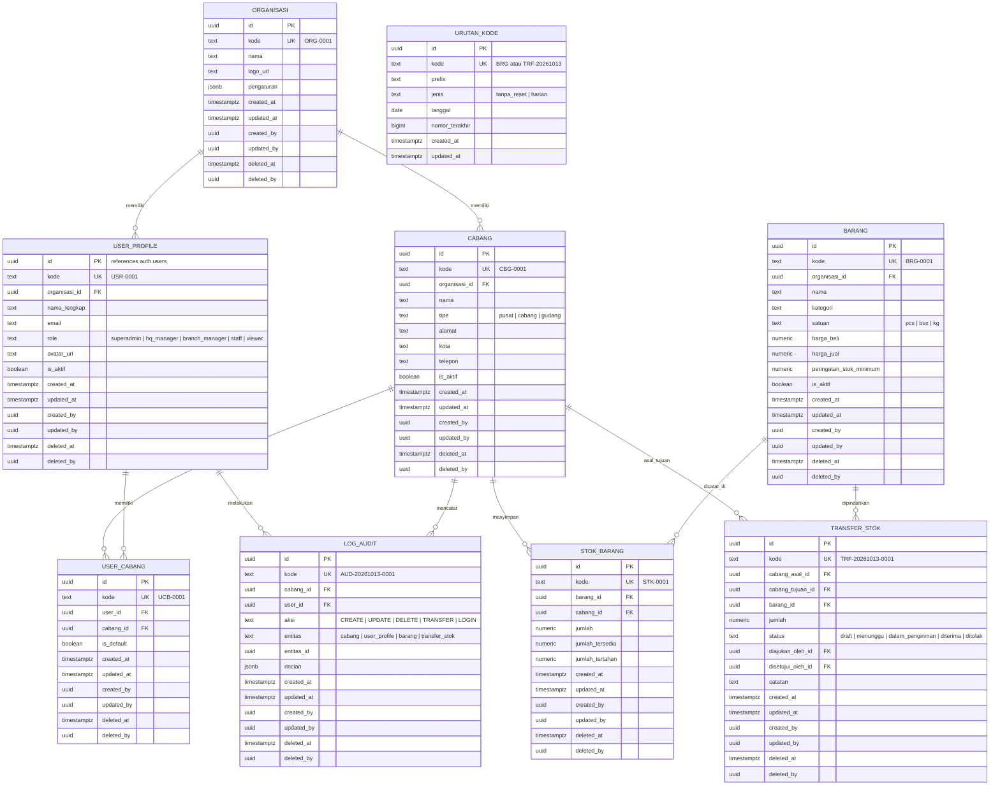

# Desain Arsitektur & Spesifikasi: Zeropoint Multi-Branch Admin Dashboard Template

## 1. Ringkasan Eksekutif & Visi Produk
**Zeropoint** adalah template admin dashboard perusahaan modern yang modular dan dapat digunakan kembali (*reusable foundation*) untuk satu perusahaan dengan struktur banyak cabang dan gudang (*multi-branch & multi-warehouse*).

Template ini dirancang untuk menyelesaikan tantangan arsitektur umum pada sistem internal perusahaan:
- **Isolasi dan Scoping Data Antar Cabang**: Data transaksi, stok, dan operasional otomatis terfilter berdasarkan cabang/gudang yang sedang aktif.
- **Hierarki Akses & Keamanan Bertingkat**: Superadmin/HQ memiliki akses menyeluruh ke semua cabang, sedangkan staf operasional terkunci pada cabang yang ditugaskan.
- **Standar Skema Database Konsisten**: Mengikuti aturan penamaan Bahasa Indonesia dalam format *snake_case* tunggal, kode bisnis human-readable otomatis, dan jejak audit/soft-delete menyeluruh.
- **Fondasi Siap Pakai (*Turnkey Architecture*)**: Dilengkapi modul dasar esensial (Cabang, Pengguna & Hak Akses, Inventaris & Mutasi Stok, Audit Trail, Pengaturan Organisasi) sebagai referensi standar implementasi modul bisnis apa pun di masa mendatang.

---

## 2. Tech Stack & Ekosistem

| Komponen | Pilihan Teknologi | Rincian / Kegunaan |
| :--- | :--- | :--- |
| **Framework** | Next.js (App Router) | React Server Components (RSC), Server Actions, Route Handlers |
| **Bahasa & Validasi** | TypeScript & Zod | *End-to-end type safety*, skema validasi form & server action |
| **UI Library** | shadcn/ui | Inisialisasi: `pnpm dlx shadcn@latest init --preset b7BFgU2rI --template next`<br/>Sidebar: `npx shadcn@latest add sidebar-07` |
| **Styling & Tema** | Tailwind CSS v4 & Lucide Icons | Dark/Light mode support dengan `next-themes` |
| **Backend & DB** | Supabase | PostgreSQL, Supabase Auth, Row-Level Security (RLS), Storage |
| **Supabase Client** | `@supabase/ssr` | Session handling aman via cookies di Server Components, Server Actions, dan Middleware |
| **Data Tables** | TanStack Table | Sorting, filtering, paginasi, density switch, dan export |
| **Form Handling** | React Hook Form | Integrasi form reaktif dengan Zod resolver |
| **Internasionalisasi** | Dictionary / i18n Ready | Default Bahasa Indonesia, toggle English, format IDR dan zona waktu WIB |
| **Testing & Tooling** | Vitest + Testing Library, ESLint, Prettier | Unit test untuk utilitas & komponen kunci, GitHub Actions CI workflow |

---

## 3. Arsitektur Multi-Branch & Data Scoping

### 3.1. Mekanisme Active Branch (Global Branch Switcher)
1. **Penyimpanan State Cabang**:
   - Cabang yang sedang aktif disimpan dalam HTTP cookie (`zeropoint_active_branch_id`).
   - Cookie dibaca secara sinkron di sisi server oleh Server Components dan Middleware Next.js.
2. **UI Placement**:
   - Terintegrasi di bagian atas `sidebar-07` (Header Sidebar) menggantikan team switcher default.
   - Menampilkan:
     - Nama cabang/gudang yang aktif
     - Badge tipe lokasi (`HQ / Pusat`, `Cabang`, `Gudang`)
     - Tombol dropdown pencarian & perpindahan cabang cepat
     - Opsi `"Semua Cabang / Konsolidasi"` (hanya dapat dipilih oleh role Superadmin atau HQ Manager)
3. **Penyaringan Data Otomatis**:
   - Setiap query database di Server Component/Action membaca `active_branch_id`.
   - Jika role pengguna adalah staf cabang, query dibatasi ketat ke cabang yang ditugaskan melalui RLS database.
   - Jika Superadmin memilih cabang tertentu, UI dan data difokuskan ke cabang tersebut.

```
+-----------------------------------------------------------+
| [Zeropoint Logo]                                          |
| [Dropdown: Cabang Utama Jakarta (HQ) v]  <-- Switcher      |
+-----------------------------------------------------------+
| Navigation (sidebar-07)                                   |
| - Dashboard                                               |
| - Cabang & Gudang                                         |
| - Pengguna & Hak Akses                                    |
| - Inventaris & Stok                                       |
| - Mutasi / Transfer Antar Cabang                          |
| - Audit Log                                               |
| - Pengaturan                                              |
+-----------------------------------------------------------+
```

---

## 4. Role-Based Access Control (RBAC) & Keamanan

### 4.1. Tingkatan Role
1. **Superadmin (Owner/Direksi)**:
   - Akses penuh tanpa batas ke seluruh data, cabang, pengaturan sistem, dan manajemen user.
   - Dapat berpindah ke cabang mana pun atau melihat agregasi "Semua Cabang".
2. **HQ Manager (Manajer Pusat)**:
   - Akses lintas cabang untuk melihat laporan, inventaris, dan memvalidasi transfer stok.
   - Tidak dapat mengubah konfigurasi sensitif sistem dan hak akses Superadmin.
3. **Branch Manager (Kepala Cabang / Kepala Gudang)**:
   - Akses penuh untuk operasional dalam cabang/gudang yang ditugaskan kepadanya.
   - Dapat mengelola staf internal cabangnya dan menyetujui mutasi stok cabang.
4. **Staff / Operator**:
   - Akses input data transaksi dan update stok hanya pada cabang aktif miliknya.
5. **Viewer / Auditor**:
   - Akses *read-only* (hanya lihat) untuk audit data dan pelaporan.

### 4.2. Model Relasi Akses Pengguna ke Cabang
- Pengguna ditugaskan ke satu atau beberapa cabang melalui tabel relasi `user_cabang`.
- Superadmin secara otomatis memiliki hak akses ke semua cabang (`is_superadmin = true`).

---

## 5. Konvensi & Skema Database Supabase

### 5.1. Aturan Baku Database (*Database Conventions*)
1. **Bahasa & Nomenklatur**:
   - Nama tabel dan kolom menggunakan **Bahasa Indonesia**, format **`snake_case`**, dan **bentuk tunggal (singular)** (contoh: `organisasi`, `cabang`, `barang`, `stok_barang`, `transfer_stok`, `log_audit`, `urutan_kode`).
   - **Pengecualian**: Istilah teknis standar seperti `user` (contoh: `user_profile`, `user_cabang`, `user_id`, `role`, `email`, `avatar_url`) dan kolom sistem baku.
2. **Kunci Primer (Primary Key)**:
   - Setiap tabel wajib memiliki kolom `id` bertipe `UUID PRIMARY KEY DEFAULT gen_random_uuid()`.
3. **Kode Bisnis Unik (*Human-Readable Code*)**:
   - Setiap tabel wajib memiliki kolom `kode` bertipe `TEXT UNIQUE NOT NULL` sebagai identitas bisnis yang mudah dibaca pengguna (misalnya: `ORG-0001`, `CBG-0001`, `BRG-0001`, `TRF-20261013-0001`).
4. **Konvensi Relasi (Foreign Key)**:
   - Semua relasi foreign key menggunakan format **`<tabel>_id`** bertipe `UUID` (contoh: `organisasi_id`, `cabang_id`, `barang_id`, `user_id`).
   - Untuk relasi ganda ke tabel yang sama, gunakan peran yang jelas dengan akhiran `_id` (contoh: `cabang_asal_id`, `cabang_tujuan_id`, `diajukan_oleh_id`).
5. **Kolom Sistem Wajib (*Audit & Soft Delete*)**:
   - Setiap tabel operasional wajib memiliki 6 kolom sistem:
     - `created_at TIMESTAMPTZ DEFAULT now() NOT NULL`
     - `updated_at TIMESTAMPTZ DEFAULT now() NOT NULL`
     - `created_by UUID REFERENCES auth.users(id)`
     - `updated_by UUID REFERENCES auth.users(id)`
     - `deleted_at TIMESTAMPTZ` (penanda soft delete; null berarti aktif)
     - `deleted_by UUID REFERENCES auth.users(id)`

---

### 5.2. Entity Relationship Diagram (ERD)



---

### 5.3. Generator Kode Otomatis & Sinkronisasi Sequence

Untuk menjamin pembuatan kode bisnis yang unik, berurutan, aman dari *race condition* (*concurrency safe*), serta tidak pernah mundur meskipun ada data seed/import manual, diimplementasikan tabel `urutan_kode` dan dua fungsi PostgreSQL atomik:

#### 1. Tabel `urutan_kode`
```sql
CREATE TABLE IF NOT EXISTS urutan_kode (
    id UUID PRIMARY KEY DEFAULT gen_random_uuid(),
    kode TEXT UNIQUE NOT NULL,               -- Kunci sekuens, misal: 'BRG' atau 'TRF-20261013'
    prefix TEXT NOT NULL,                   -- Prefix kode, misal: 'BRG', 'TRF', 'CBG'
    jenis TEXT NOT NULL,                    -- 'tanpa_reset' | 'harian'
    tanggal DATE,                           -- Diisi jika jenis = 'harian', NULL jika 'tanpa_reset'
    nomor_terakhir BIGINT DEFAULT 0 NOT NULL,
    created_at TIMESTAMPTZ DEFAULT now() NOT NULL,
    updated_at TIMESTAMPTZ DEFAULT now() NOT NULL
);

CREATE INDEX IF NOT EXISTS idx_urutan_kode_kunci ON urutan_kode(kode);
```

#### 2. Fungsi Atomik `buat_kode(prefix, panjang, jenis, tanggal)`
Fungsi ini melakukan *atomic upsert* dengan locking baris bawaan PostgreSQL (`ON CONFLICT DO UPDATE`) untuk menghasilkan format:
- **`tanpa_reset`**: `PREFIX-0001` (nomor urut terus berlanjut tanpa batas waktu).
- **`harian`**: `PREFIX-YYYYMMDD-0001` (nomor urut otomatis reset kembali ke 1 setiap hari baru).

```sql
CREATE OR REPLACE FUNCTION buat_kode(
    p_prefix TEXT,
    p_panjang INT DEFAULT 4,
    p_jenis TEXT DEFAULT 'tanpa_reset',
    p_tanggal DATE DEFAULT CURRENT_DATE
) RETURNS TEXT
LANGUAGE plpgsql
SECURITY DEFINER
AS $$
DECLARE
    v_kunci TEXT;
    v_nomor BIGINT;
    v_tanggal_str TEXT;
    v_hasil TEXT;
BEGIN
    -- Validasi jenis
    IF p_jenis NOT IN ('tanpa_reset', 'harian') THEN
        RAISE EXCEPTION 'Jenis kode tidak valid: %. Gunakan "tanpa_reset" atau "harian"', p_jenis;
    END IF;

    -- Tentukan kunci unik urutan
    IF p_jenis = 'harian' THEN
        v_tanggal_str := to_char(p_tanggal, 'YYYYMMDD');
        v_kunci := p_prefix || '-' || v_tanggal_str;
    ELSE
        v_tanggal_str := NULL;
        v_kunci := p_prefix;
    END IF;

    -- Atomic Upsert & increment
    INSERT INTO urutan_kode (kode, prefix, jenis, tanggal, nomor_terakhir, updated_at)
    VALUES (v_kunci, p_prefix, p_jenis, p_tanggal, 1, now())
    ON CONFLICT (kode)
    DO UPDATE SET
        nomor_terakhir = urutan_kode.nomor_terakhir + 1,
        updated_at = now()
    RETURNING nomor_terakhir INTO v_nomor;

    -- Format hasil kode
    IF p_jenis = 'harian' THEN
        v_hasil := p_prefix || '-' || v_tanggal_str || '-' || lpad(v_nomor::TEXT, p_panjang, '0');
    ELSE
        v_hasil := p_prefix || '-' || lpad(v_nomor::TEXT, p_panjang, '0');
    END IF;

    RETURN v_hasil;
END;
$$;
```

#### 3. Fungsi Sinkronisasi `sinkron_urutan_kode(...)`
Fungsi ini membaca kode tertinggi yang telah ada pada tabel data (misal setelah proses seeding, migrasi, atau manual insert). Jika nomor tertinggi di tabel lebih besar dari `nomor_terakhir` pada `urutan_kode`, nilai di `urutan_kode` akan dimajukan secara otomatis sehingga **penomoran tidak akan pernah mundur atau menghasilkan kode duplikat**.

```sql
CREATE OR REPLACE FUNCTION sinkron_urutan_kode(
    p_nama_tabel TEXT,
    p_kolom_kode TEXT,
    p_prefix TEXT,
    p_jenis TEXT DEFAULT 'tanpa_reset',
    p_tanggal DATE DEFAULT CURRENT_DATE
) RETURNS BIGINT
LANGUAGE plpgsql
SECURITY DEFINER
AS $$
DECLARE
    v_kunci TEXT;
    v_pola_regex TEXT;
    v_nomor_tertinggi BIGINT := 0;
    v_nomor_sekarang BIGINT := 0;
    v_sql TEXT;
    v_tanggal_str TEXT;
BEGIN
    IF p_jenis = 'harian' THEN
        v_tanggal_str := to_char(p_tanggal, 'YYYYMMDD');
        v_kunci := p_prefix || '-' || v_tanggal_str;
        v_pola_regex := '^' || p_prefix || '-' || v_tanggal_str || '-([0-9]+)$';
    ELSE
        v_tanggal_str := NULL;
        v_kunci := p_prefix;
        v_pola_regex := '^' || p_prefix || '-([0-9]+)$';
    END IF;

    -- Ambil nomor urut tertinggi yang ada di tabel tujuan menggunakan regex capture
    v_sql := format(
        'SELECT COALESCE(MAX((substring(%I from %L))::BIGINT), 0) FROM %I WHERE %I ~ %L',
        p_kolom_kode, v_pola_regex, p_nama_tabel, p_kolom_kode, v_pola_regex
    );
    EXECUTE v_sql INTO v_nomor_tertinggi;

    -- Ambil nomor terakhir saat ini di tabel urutan_kode
    SELECT nomor_terakhir INTO v_nomor_sekarang
    FROM urutan_kode
    WHERE kode = v_kunci;

    -- Sinkronisasi: nomor tidak boleh mundur
    IF v_nomor_sekarang IS NULL THEN
        INSERT INTO urutan_kode (kode, prefix, jenis, tanggal, nomor_terakhir, updated_at)
        VALUES (v_kunci, p_prefix, p_jenis, p_tanggal, v_nomor_tertinggi, now());
    ELSIF v_nomor_tertinggi > v_nomor_sekarang THEN
        UPDATE urutan_kode
        SET nomor_terakhir = v_nomor_tertinggi,
            updated_at = now()
        WHERE kode = v_kunci;
    END IF;

    RETURN GREATEST(COALESCE(v_nomor_sekarang, 0), v_nomor_tertinggi);
END;
$$;
```

#### 4. Trigger Otomatis untuk Kolom `kode`
Setiap tabel dapat memanfaatkan default trigger `BEFORE INSERT` untuk mengisi kolom `kode` secara otomatis jika tidak disertakan:
```sql
CREATE OR REPLACE FUNCTION trg_set_kode_barang()
RETURNS TRIGGER AS $$
BEGIN
    IF NEW.kode IS NULL OR NEW.kode = '' THEN
        NEW.kode := buat_kode('BRG', 4, 'tanpa_reset');
    END IF;
    RETURN NEW;
END;
$$ LANGUAGE plpgsql;

CREATE TRIGGER trigger_set_kode_barang
BEFORE INSERT ON barang
FOR EACH ROW EXECUTE FUNCTION trg_set_kode_barang();
```

---

### 5.4. Supabase Row-Level Security (RLS) Helper Functions
1. `auth.is_superadmin()`:
   ```sql
   CREATE OR REPLACE FUNCTION auth.is_superadmin()
   RETURNS BOOLEAN AS $$
   BEGIN
       RETURN EXISTS (
           SELECT 1 FROM user_profile
           WHERE id = auth.uid() AND role = 'superadmin' AND is_aktif = true AND deleted_at IS NULL
       );
   END;
   $$ LANGUAGE plpgsql SECURITY DEFINER;
   ```
2. `auth.has_branch_access(target_cabang_id UUID)`:
   ```sql
   CREATE OR REPLACE FUNCTION auth.has_branch_access(target_cabang_id UUID)
   RETURNS BOOLEAN AS $$
   BEGIN
       -- Superadmin & HQ Manager memiliki akses lintas cabang
       IF EXISTS (
           SELECT 1 FROM user_profile
           WHERE id = auth.uid() AND role IN ('superadmin', 'hq_manager') AND is_aktif = true AND deleted_at IS NULL
       ) THEN
           RETURN true;
       END IF;

       -- Staf & Manajer Cabang dibatasi pada cabang yang terdaftar di user_cabang
       RETURN EXISTS (
           SELECT 1 FROM user_cabang uc
           JOIN user_profile up ON up.id = uc.user_id
           WHERE uc.user_id = auth.uid()
             AND uc.cabang_id = target_cabang_id
             AND up.is_aktif = true
             AND uc.deleted_at IS NULL
             AND up.deleted_at IS NULL
       );
   END;
   $$ LANGUAGE plpgsql SECURITY DEFINER;
   ```
3. Filter soft-delete otomatis pada RLS: `deleted_at IS NULL`.

---

## 6. Modul Bawaan Template (Starter Reference Modules)

1. **Dashboard Ringkasan (*Overview*)**:
   - Kartu KPI: Total Cabang Aktif, Nilai Total Stok, Mutasi Berstatus Menunggu, Peringatan Stok Minimum.
   - Grafik distribusi inventaris per cabang dan riwayat mutasi bulanan.
2. **Manajemen Cabang & Gudang (`cabang`)**:
   - Data Table dengan filter tipe (`pusat`, `cabang`, `gudang`) dan status aktif.
   - Form Tambah/Edit Cabang: Kode otomatis (`CBG-0001`), alamat, kota, telepon, penanggung jawab.
3. **Manajemen Pengguna & Penugasan (`user_profile` & `user_cabang`)**:
   - Daftar staf dengan kode pengguna (`USR-0001`), badge role, dan chip multi-cabang.
   - Dialog undangan/tambah user baru dengan penetapan cabang default dan cabang tambahan.
4. **Katalog Barang & Inventaris (`barang` & `stok_barang`)**:
   - Master Barang: Kode (`BRG-0001`), nama, kategori, satuan, harga beli/jual, batas minimum stok.
   - Rincian Stok Cabang: Menampilkan jumlah fisik, jumlah tersedia, dan jumlah tertahan per cabang aktif.
5. **Mutasi & Transfer Stok Antar Cabang (`transfer_stok`)**:
   - Kode mutasi harian (`TRF-20261013-0001`).
   - Alur status: `draft` -> `menunggu` -> `dalam_pengiriman` -> `diterima` (atau `ditolak`).
   - Validasi otomatis: Mengurangi `jumlah_tersedia` di cabang asal dan menambah `jumlah` di cabang tujuan saat diterima.
6. **Log Audit & Jejak Aktivitas (`log_audit`)**:
   - Kode audit harian (`AUD-20261013-0001`).
   - Pelacakan otomatis setiap aksi create, update, soft delete, transfer, dan login.
7. **Pengaturan Organisasi (`organisasi`)**:
   - Profil entitas perusahaan, logo, kontak, preferensi mata uang (IDR default), dan pengaturan sistem.

---

## 7. Struktur Folder Proyek (Next.js App Router)

```
zeropoint/
├── .github/
│   └── workflows/
│       └── ci.yml                     # Linting, Typecheck, Unit Tests
├── docs/
│   └── superpowers/specs/             # Spesifikasi arsitektur & desain
├── src/
│   ├── app/
│   │   ├── (auth)/
│   │   │   ├── login/                 # Halaman login
│   │   │   └── layout.tsx
│   │   ├── (dashboard)/
│   │   │   ├── layout.tsx             # Shell dashboard (sidebar-07 + header)
│   │   │   ├── page.tsx               # Overview dashboard
│   │   │   ├── cabang/                # Modul Manajemen Cabang & Gudang
│   │   │   ├── user/                  # Modul Manajemen User & Hak Akses
│   │   │   ├── barang/                # Modul Stok & Master Barang
│   │   │   ├── transfer-stok/         # Modul Mutasi Antar Cabang
│   │   │   ├── log-audit/             # Modul Log Aktivitas
│   │   │   └── pengaturan/            # Modul Pengaturan Organisasi
│   │   ├── api/                       # Webhooks / Auth callbacks
│   │   ├── globals.css                # Tailwind CSS v4 styling
│   │   └── layout.tsx
│   ├── components/
│   │   ├── ui/                        # Komponen shadcn/ui
│   │   ├── layout/
│   │   │   ├── app-sidebar.tsx        # Implementasi sidebar-07
│   │   │   ├── branch-switcher.tsx    # Dropdown ganti cabang aktif di sidebar
│   │   │   ├── header-nav.tsx         # Breadcrumbs, quick actions, theme toggle
│   │   │   └── user-nav.tsx           # Avatar dropdown & logout
│   │   └── shared/                    # Data-table, confirm dialog, empty state
│   ├── hooks/
│   │   ├── use-active-branch.ts       # Hook akses cabang aktif
│   │   └── use-permissions.ts         # Hook verifikasi hak akses UI
│   ├── lib/
│   │   ├── supabase/
│   │   │   ├── client.ts              # Browser Supabase client
│   │   │   ├── server.ts              # Server Supabase client (@supabase/ssr)
│   │   │   └── middleware.ts          # Middleware auth & branch session
│   │   ├── i18n/                      # Dictionary bahasa (ID / EN)
│   │   └── utils.ts
│   ├── server/
│   │   ├── actions/                   # Server Actions terisolasi (cabang, user, barang, transfer)
│   │   └── queries/                   # Database queries terisolasi
│   └── types/
│       ├── database.types.ts          # Generated types Supabase
│       └── index.ts
├── supabase/
│   ├── migrations/                    # File migrasi SQL Supabase
│   │   └── 20261013000000_skema_dasar_multicabang.sql
│   └── seed.sql                       # Data inisialisasi awal & pemicu sinkronisasi kode
├── tests/                             # Vitest unit test
├── package.json
├── pnpm-lock.yaml
├── tsconfig.json
└── README.md
```

---

## 8. Alur Implementasi (Execution Blueprint)

1. **Tahap 1: Inisialisasi Proyek & UI Foundation**:
   - Jalankan `pnpm dlx shadcn@latest init --preset b7BFgU2rI --template next`.
   - Pasang blok sidebar: `npx shadcn@latest add sidebar-07`.
   - Pasang komponen UI esensial shadcn: `button`, `dialog`, `dropdown-menu`, `input`, `select`, `table`, `badge`, `card`, `avatar`, `tabs`, `sonner`.
2. **Tahap 2: Setup Database & Supabase Integration**:
   - Buat file migrasi `supabase/migrations/20261013000000_skema_dasar_multicabang.sql` berisi:
     - Tabel `urutan_kode`, fungsi `buat_kode`, dan fungsi `sinkron_urutan_kode`.
     - Tabel `organisasi`, `cabang`, `user_profile`, `user_cabang`, `barang`, `stok_barang`, `transfer_stok`, `log_audit`.
     - 6 Kolom sistem (`created_at`, `updated_at`, `created_by`, `updated_by`, `deleted_at`, `deleted_by`) dan trigger `updated_at`.
     - Kebijakan Supabase Row-Level Security (RLS).
   - Buat `supabase/seed.sql` berisi akun default Superadmin (`admin@zeropoint.com`), cabang demo (`HQ-0001`, `CBG-0001`, `GDG-0001`), master barang dummy, dan eksekusi `sinkron_urutan_kode` di akhir seed.
   - Konfigurasi `@supabase/ssr` dengan pembacaan cookie `zeropoint_active_branch_id`.
3. **Tahap 3: Implementasi Shell Dashboard & Branch Switcher**:
   - Integrasikan `BranchSwitcher` di header `sidebar-07` dengan sinkronisasi cookie server action.
4. **Tahap 4: Implementasi Modul-Modul Bawaan**:
   - Halaman Cabang & Gudang (`/cabang`)
   - Halaman Pengguna & Hak Akses (`/user`)
   - Halaman Inventaris & Stok (`/barang`)
   - Halaman Mutasi Antar Cabang (`/transfer-stok`)
   - Halaman Log Audit (`/log-audit`) & Pengaturan (`/pengaturan`)
5. **Tahap 5: Kualitas & DX**:
   - Unit test generator kode & branch scoping dengan Vitest.
   - Konfigurasi ESLint & Prettier.
   - GitHub Actions CI workflow.
