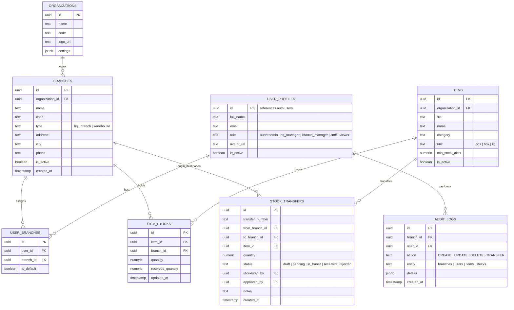

# Desain Arsitektur & Spesifikasi: Zeropoint Multi-Branch Admin Dashboard Template

## 1. Ringkasan Eksekutif & Visi Produk
**Zeropoint** adalah template admin dashboard perusahaan modern yang modular dan dapat digunakan kembali (*reusable foundation*) untuk satu perusahaan dengan struktur banyak cabang dan gudang (*multi-branch & multi-warehouse*).

Template ini dirancang untuk menyelesaikan tantangan arsitektur umum pada sistem internal perusahaan:
- **Isolasi dan Scoping Data Antar Cabang**: Data transaksi, stok, dan operasional otomatis terfilter berdasarkan cabang/gudang yang sedang aktif.
- **Hierarki Akses & Keamanan Bertingkat**: Superadmin/HQ memiliki akses menyeluruh ke semua cabang, sedangkan staf operasional terkunci pada cabang yang ditugaskan.
- **Fondasi Siap Pakai (*Turnkey Architecture*)**: Dilengkapi modul dasar esensial (Cabang, Pengguna & Hak Akses, Inventaris & Mutasi Stok, Audit Trail, Pengaturan Organisasi) sebagai referensi standar implementasi modul bisnis apa pun di masa mendatang.

---

## 2. Tech Stack & Ekosistem

| Komponen | Pilihan Teknologi | Rincian / Kegunaan |
| :--- | :--- | :--- |
| **Framework** | Next.js (App Router) | React Server Components (RSC), Server Actions, Route Handlers |
| **Bahasa & Validasi** | TypeScript & Zod | *End-to-end type safety*, skema validasi form & server action |
| **UI Library** | shadcn/ui | Inisialisasi: `pnpm dlx shadcn@latest init --preset b7BFgU2rI --template next`<br/>Sidebar: `npx shadcn@latest add sidebar-07` |
| **Styling & Tema** | Tailwind CSS v4 & Lucide Icons | Dark/Light mode support dengan `next-themes` |
| **Backend & DB** | Supabase | PostgreSQL, Supabase Auth, Row-Level Security (RLS), Storage |
| **Supabase Client** | `@supabase/ssr` | Session handling aman via cookies di Server Components, Server Actions, dan Middleware |
| **Data Tables** | TanStack Table | Sorting, filtering, paginasi, density switch, dan export |
| **Form Handling** | React Hook Form | Integrasi form reaktif dengan Zod resolver |
| **Internasionalisasi** | Dictionary / i18n Ready | Default Bahasa Indonesia, toggle English, format IDR dan zona waktu WIB |
| **Testing & Tooling** | Vitest + Testing Library, ESLint, Prettier | Unit test untuk utilitas & komponen kunci, GitHub Actions CI workflow |

---

## 3. Arsitektur Multi-Branch & Data Scoping

### 3.1. Mekanisme Active Branch (Global Branch Switcher)
1. **Penyimpanan State Cabang**:
   - Cabang yang sedang aktif disimpan dalam HTTP cookie (`zeropoint_active_branch_id`).
   - Cookie dibaca secara sinkron di sisi server oleh Server Components dan Middleware Next.js.
2. **UI Placement**:
   - Terintegrasi di bagian atas `sidebar-07` (Header Sidebar) menggantikan team switcher default.
   - Menampilkan:
     - Nama cabang/gudang yang aktif
     - Badge tipe lokasi (`HQ / Pusat`, `Cabang`, `Gudang`)
     - Tombol dropdown pencarian & perpindahan cabang cepat
     - Opsi `"Semua Cabang / Konsolidasi"` (hanya dapat dipilih oleh role Superadmin atau HQ Manager)
3. **Penyaringan Data Otomatis**:
   - Setiap query database di Server Component/Action membaca `active_branch_id`.
   - Jika role pengguna adalah staf cabang, query dibatasi ketat ke cabang yang ditugaskan melalui RLS database.
   - Jika Superadmin memilih cabang tertentu, UI dan data difokuskan ke cabang tersebut.

```
+-----------------------------------------------------------+
| [Zeropoint Logo]                                          |
| [Dropdown: Cabang Utama Jakarta (HQ) v]  <-- Switcher      |
+-----------------------------------------------------------+
| Navigation (sidebar-07)                                   |
| - Dashboard                                               |
| - Cabang & Gudang                                         |
| - Pengguna & Hak Akses                                    |
| - Inventaris & Stok                                       |
| - Mutasi / Transfer Antar Cabang                          |
| - Audit Log                                               |
| - Pengaturan                                              |
+-----------------------------------------------------------+
```

---

## 4. Role-Based Access Control (RBAC) & Keamanan

### 4.1. Tingkatan Role
1. **Superadmin (Owner/Direksi)**:
   - Akses penuh tanpa batas ke seluruh data, cabang, pengaturan sistem, dan manajemen user.
   - Dapat berpindah ke cabang mana pun atau melihat agregasi "Semua Cabang".
2. **HQ Manager (Manajer Pusat)**:
   - Akses lintas cabang untuk melihat laporan, inventaris, dan memvalidasi transfer stok.
   - Tidak dapat mengubah konfigurasi sensitif sistem dan hak akses Superadmin.
3. **Branch Manager (Kepala Cabang / Kepala Gudang)**:
   - Akses penuh untuk operasional dalam cabang/gudang yang ditugaskan kepadanya.
   - Dapat mengelola staf internal cabangnya dan menyetujui mutasi stok cabang.
4. **Staff / Operator**:
   - Akses input data transaksi dan update stok hanya pada cabang aktif miliknya.
5. **Viewer / Auditor**:
   - Akses *read-only* (hanya lihat) untuk audit data dan pelaporan.

### 4.2. Model Relasi Akses Pengguna ke Cabang
- Seorang pengguna dapat ditugaskan ke satu atau beberapa cabang melalui tabel relasi `user_branches`.
- Superadmin secara otomatis memiliki hak akses ke semua cabang (`is_superadmin = true`).

---

## 5. Skema Database & Supabase RLS

### 5.1. Entitas Inti


### 5.2. Supabase Row-Level Security (RLS) Helper Functions
- `auth.is_superadmin()`: Mengembalikan `true` jika user adalah Superadmin.
- `auth.has_branch_access(target_branch_id uuid)`: Mengembalikan `true` jika user adalah Superadmin, atau memiliki record di `user_branches` untuk cabang tersebut.
- Setiap tabel transaksi/stok dilindungi dengan kebijakan `USING (auth.has_branch_access(branch_id))`.

---

## 6. Modul Bawaan Template (Starter Reference Modules)

1. **Dashboard Ringkasan (*Overview*)**:
   - Kartu Metrik KPI (Total Cabang Aktif, Total Nilai Inventaris, Mutasi Pending, Peringatan Stok Minimum).
   - Grafik distribusi inventaris per cabang & tren mutasi bulanan.
2. **Manajemen Cabang & Gudang**:
   - List & Filter data cabang (Tipe: HQ, Cabang, Gudang; Status aktif).
   - Dialog form Tambah/Ubah Cabang dengan koordinat/alamat dan penanggung jawab.
3. **Manajemen Pengguna & Penugasan Cabang**:
   - Daftar staf & administrator dengan badge role dan multi-branch chips.
   - Form undang/tambah user baru dengan pemilihan cabang default dan multi-cabang.
4. **Katalog Barang & Inventaris (Multi-Branch)**:
   - Master item/SKU dengan harga, kategori, dan stok teragregasi.
   - Detail item dengan rincian stok per masing-masing cabang/gudang.
5. **Mutasi & Transfer Stok Antar Cabang**:
   - Alur pengiriman barang dari Gudang A ke Cabang B.
   - Alur status: *Draft -> Pending Approval -> In Transit -> Received*.
6. **Audit Trail & Log Aktivitas**:
   - Pencatatan otomatis riwayat aksi user (waktu, pelaku, cabang, aksi, detail perubahan).
7. **Pengaturan Organisasi**:
   - Profil perusahaan, logo, kontak, preferensi format mata uang (IDR/USD), dan switch tema (Light/Dark).

---

## 7. Struktur Folder Proyek (Next.js App Router)

```
zeropoint/
├── .github/
│   └── workflows/
│       └── ci.yml                     # Linting, Typecheck, Unit Tests
├── docs/
│   └── superpowers/specs/             # Spesifikasi arsitektur & desain
├── src/
│   ├── app/
│   │   ├── (auth)/
│   │   │   ├── login/                 # Halaman login
│   │   │   └── layout.tsx
│   │   ├── (dashboard)/
│   │   │   ├── layout.tsx             # Shell dashboard (sidebar-07 + header)
│   │   │   ├── page.tsx               # Overview dashboard
│   │   │   ├── branches/              # Modul Manajemen Cabang & Gudang
│   │   │   ├── users/                 # Modul Manajemen User & Hak Akses
│   │   │   ├── inventory/             # Modul Stok & Master Barang
│   │   │   ├── transfers/             # Modul Mutasi Antar Cabang
│   │   │   ├── audit-logs/            # Modul Log Aktivitas
│   │   │   └── settings/              # Modul Pengaturan Organisasi
│   │   ├── api/                       # Webhooks / Auth callbacks
│   │   ├── globals.css                # Tailwind CSS v4 styling
│   │   └── layout.tsx
│   ├── components/
│   │   ├── ui/                        # Komponen shadcn/ui
│   │   ├── layout/
│   │   │   ├── app-sidebar.tsx        # Implementasi sidebar-07
│   │   │   ├── branch-switcher.tsx    # Dropdown ganti cabang aktif di sidebar
│   │   │   ├── header-nav.tsx         # Breadcrumbs, quick actions, theme toggle
│   │   │   └── user-nav.tsx           # Avatar dropdown & logout
│   │   └── shared/                    # Data-table, confirm dialog, empty state
│   ├── hooks/
│   │   ├── use-active-branch.ts       # Hook akses cabang aktif
│   │   └── use-permissions.ts         # Hook verifikasi hak akses UI
│   ├── lib/
│   │   ├── supabase/
│   │   │   ├── client.ts              # Browser Supabase client
│   │   │   ├── server.ts              # Server Supabase client (@supabase/ssr)
│   │   │   └── middleware.ts          # Middleware auth & branch session
│   │   ├── i18n/                      # Dictionary bahasa (ID / EN)
│   │   └── utils.ts
│   ├── server/
│   │   ├── actions/                   # Server Actions terisolasi (branches, users, items)
│   │   └── queries/                   # Database queries terisolasi
│   └── types/
│       ├── database.types.ts          # Generated types Supabase
│       └── index.ts
├── supabase/
│   ├── migrations/                    # File migrasi SQL Supabase
│   └── seed.sql                       # Data inisialisasi awal (Superadmin, demo cabang, dummy item)
├── tests/                             # Vitest unit test
├── package.json
├── pnpm-lock.yaml
├── tsconfig.json
└── README.md
```

---

## 8. Alur Implementasi (Execution Blueprint)

1. **Tahap 1: Inisialisasi Proyek & UI Foundation**:
   - Jalankan `pnpm dlx shadcn@latest init --preset b7BFgU2rI --template next`.
   - Pasang blok sidebar: `npx shadcn@latest add sidebar-07`.
   - Pasang komponen UI esensial shadcn: `button`, `dialog`, `dropdown-menu`, `input`, `select`, `table`, `badge`, `card`, `avatar`, `tabs`, `sonner`.
2. **Tahap 2: Setup Database & Supabase Integration**:
   - Buat file migrasi `supabase/migrations/20261013000000_init_multibranch_schema.sql` lengkap dengan skema tabel, fungsi RLS, dan triggers.
   - Buat `supabase/seed.sql` dengan akun demo Superadmin (`admin@zeropoint.com`), cabang HQ, Cabang Surabaya, Gudang Cikarang, dan dummy items.
   - Konfigurasi `@supabase/ssr` (server, client, middleware) dengan sinkronisasi cookie `zeropoint_active_branch_id`.
3. **Tahap 3: Implementasi Shell Dashboard & Branch Switcher**:
   - Sesuaikan `sidebar-07` dengan memasang `BranchSwitcher` di header sidebar.
   - Integrasikan `useActiveBranch` dan Server Action untuk mengubah cookie cabang aktif secara instan.
4. **Tahap 4: Implementasi Modul-Modul Bawaan**:
   - CRUD Cabang & Gudang dengan TanStack data-table.
   - CRUD Pengguna & Penugasan multi-cabang.
   - Katalog Inventaris & Stok per cabang.
   - Alur Mutasi/Transfer Stok antar cabang.
   - Halaman Audit Logs & Settings.
5. **Tahap 5: Kualitas & DX**:
   - Setup konfigurasi Vitest untuk utilitas & branch-scoping logic.
   - Setup GitHub Actions CI workflow (`.github/workflows/ci.yml`).
   - Panduan dokumentasi komprehensif di `README.md` cara ekstensi template untuk sistem apa pun.
