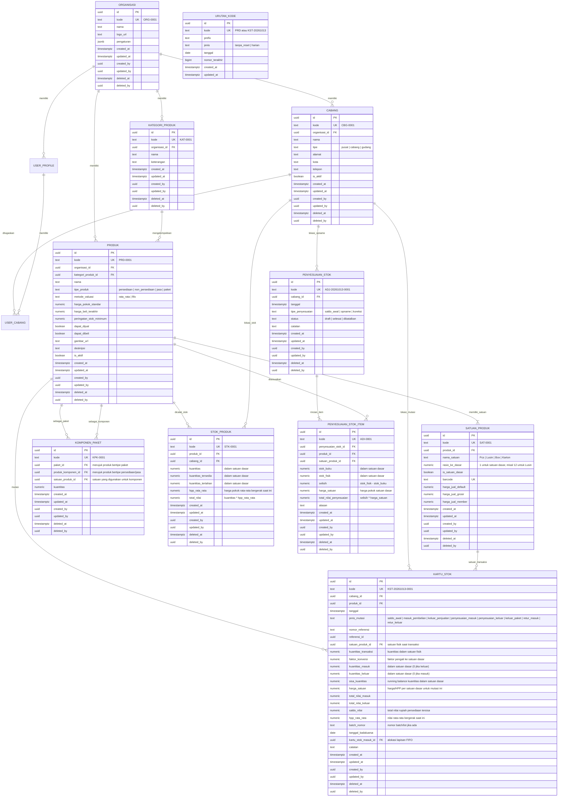

# Desain Arsitektur & Spesifikasi: Zeropoint Multi-Branch Admin Dashboard Template

## 1. Ringkasan Eksekutif & Visi Produk
**Zeropoint** adalah template admin dashboard perusahaan modern yang modular dan dapat digunakan kembali (*reusable foundation*) untuk satu perusahaan dengan struktur banyak cabang dan gudang (*multi-branch & multi-warehouse*).

Fokus utama perancangan tahap ini diarahkan pada **Master Data Produk & Persediaan Lengkap ala Software Akuntansi Accurate** (mendukung Multi-Satuan, Tipe Produk Lengkap, Paket Dinamis, Kartu Stok / *Stock Ledger*, dan Valuasi Ganda Moving Average & FIFO), sementara modul mutasi antar gudang dikesampingkan terlebih dahulu agar fondasi data produk dan persediaan benar-benar solid dan matang.

---

## 2. Tech Stack & Ekosistem

| Komponen | Pilihan Teknologi | Rincian / Kegunaan |
| :--- | :--- | :--- |
| **Framework** | Next.js (App Router) | React Server Components (RSC), Server Actions, Route Handlers |
| **Bahasa & Validasi** | TypeScript & Zod | *End-to-end type safety*, skema validasi form & server action |
| **UI Library** | shadcn/ui | Inisialisasi: `pnpm dlx shadcn@latest init --preset b7BFgU2rI --template next --rtl --pointer`<br/>Sidebar: `npx shadcn@latest add sidebar-07` |
| **Tipografi & Ikon** | Font Outfit & Hugeicons | Font: `Outfit` via `next/font/google`<br/>Ikon: `@hugeicons/react` (Stroke / Outline Rounded 1.5px) di seluruh antarmuka dan blok sidebar-07 |
| **Styling & Arah Teks** | Tailwind CSS v4 & RTL-Ready | Dark/Light mode (`next-themes`), LTR default dengan utilitas RTL-ready, cursor pointer styling aktif |
| **Backend & DB** | Supabase | PostgreSQL, Supabase Auth, Row-Level Security (RLS), Storage |
| **Supabase Client** | `@supabase/ssr` | Session handling aman via cookies di Server Components, Server Actions, dan Middleware |
| **Data Tables** | TanStack Table | Sorting, filtering, paginasi, density switch, dan export |
| **Form Handling** | React Hook Form | Integrasi form reaktif dengan Zod resolver |
| **Internasionalisasi** | Dictionary / i18n Ready | Default Bahasa Indonesia, toggle English, format IDR dan zona waktu WIB |
| **Testing & Tooling** | Vitest + Testing Library, ESLint, Prettier | Unit test untuk utilitas & komponen kunci, GitHub Actions CI workflow |

---

## 3. Arsitektur Multi-Branch & Data Scoping

### 3.1. Mekanisme Active Branch (Global Branch Switcher)
1. **Penyimpanan State Cabang**:
   - Cabang yang sedang aktif disimpan dalam HTTP cookie (`zeropoint_active_branch_id`).
   - Cookie dibaca secara sinkron di sisi server oleh Server Components dan Middleware Next.js.
2. **UI Placement**:
   - Terintegrasi di bagian atas `sidebar-07` (Header Sidebar) menggantikan team switcher default.
   - Menampilkan:
     - Nama cabang/gudang yang aktif
     - Badge tipe lokasi (`HQ / Pusat`, `Cabang`, `Gudang`)
     - Tombol dropdown pencarian & perpindahan cabang cepat
     - Opsi `"Semua Cabang / Konsolidasi"` (hanya dapat dipilih oleh role Superadmin atau HQ Manager)
3. **Penyaringan Data Otomatis**:
   - Setiap query stok produk dan kartu stok di Server Component/Action membaca `active_branch_id`.
   - Staf cabang otomatis hanya melihat stok dan kartu stok di cabangnya melalui Supabase RLS.

```
+-----------------------------------------------------------+
| [Zeropoint Logo]                                          |
| [Dropdown: Cabang Utama Jakarta (HQ) v]  <-- Switcher      |
+-----------------------------------------------------------+
| Navigation (sidebar-07)                                   |
| - Dashboard                                               |
| - Cabang & Gudang                                         |
| - Pengguna & Hak Akses                                    |
| - Master Produk (Multi-Satuan & Paket)                   |
| - Kartu Stok (Stock Ledger)                               |
| - Penyesuaian Stok (Stock Opname)                         |
| - Audit Log                                               |
| - Pengaturan                                              |
+-----------------------------------------------------------+
```

---

## 4. Role-Based Access Control (RBAC) & Keamanan

### 4.1. Tingkatan Role
1. **Superadmin (Owner/Direksi)**:
   - Akses penuh tanpa batas ke seluruh data, cabang, master produk, kartu stok semua cabang, dan pengaturan sistem.
2. **HQ Manager (Manajer Pusat)**:
   - Akses lintas cabang untuk melihat laporan stok terpusat, mengelola master produk, dan verifikasi opname.
3. **Branch Manager (Kepala Cabang / Kepala Gudang)**:
   - Akses operasional dalam cabang/gudang miliknya (melihat kartu stok cabang, melakukan penyesuaian stok cabang).
4. **Staff / Operator**:
   - Akses input operasional pada cabang aktif yang ditugaskan.
5. **Viewer / Auditor**:
   - Akses *read-only* untuk audit kartu stok dan laporan inventaris.

---

## 5. Konvensi & Skema Database Supabase

### 5.1. Aturan Baku Database (*Database Conventions*)
1. **Bahasa & Nomenklatur**:
   - Nama tabel dan kolom menggunakan **Bahasa Indonesia**, format **`snake_case`**, dan **bentuk tunggal (singular)** (misalnya: `organisasi`, `cabang`, `produk`, `satuan_produk`, `komponen_paket`, `stok_produk`, `kartu_stok`, `penyesuaian_stok`, `penyesuaian_stok_item`, `log_audit`, `urutan_kode`).
   - **Pengecualian**: Istilah teknis standar seperti `user` (`user_profile`, `user_cabang`, `user_id`, `role`, `email`, `avatar_url`) dan kolom sistem baku.
2. **Kunci Primer (Primary Key)**:
   - Setiap tabel wajib memiliki kolom `id` bertipe `UUID PRIMARY KEY DEFAULT gen_random_uuid()`.
3. **Kode Bisnis Unik (*Human-Readable Code*)**:
   - Setiap tabel wajib memiliki kolom `kode` bertipe `TEXT UNIQUE NOT NULL` sebagai identitas bisnis yang mudah dibaca pengguna (misal: `ORG-0001`, `CBG-0001`, `PRD-0001`, `KST-20261013-0001`, `ADJ-20261013-0001`).
4. **Konvensi Relasi (Foreign Key)**:
   - Semua relasi foreign key menggunakan format **`<tabel>_id`** bertipe `UUID` (contoh: `organisasi_id`, `cabang_id`, `produk_id`, `satuan_produk_id`, `user_id`).
5. **Kolom Sistem Wajib (*Audit & Soft Delete*)**:
   - Setiap tabel operasional wajib memiliki 6 kolom sistem:
     - `created_at TIMESTAMPTZ DEFAULT now() NOT NULL`
     - `updated_at TIMESTAMPTZ DEFAULT now() NOT NULL`
     - `created_by UUID REFERENCES auth.users(id)`
     - `updated_by UUID REFERENCES auth.users(id)`
     - `deleted_at TIMESTAMPTZ` (penanda soft delete; null berarti aktif)
     - `deleted_by UUID REFERENCES auth.users(id)`

---

### 5.2. Entity Relationship Diagram (ERD) - Master Produk & Persediaan



---

### 5.3. Rincian Konsep Produk & Multi-Satuan ala Accurate

1. **Tipe Produk**:
   - `persediaan` (*Inventory Part*): Produk fisik yang dibeli, disimpan, dan dijual. Setiap mutasi fisik wajib dicatat di `stok_produk` dan `kartu_stok`.
   - `non_persediaan` (*Non-Inventory Part*): Produk fisik yang langsung dibeli untuk keperluan operasional/proyek tanpa perlu pelacakan saldo stok gudang.
   - `jasa` (*Service*): Jasa atau layanan yang dijual/dibeli (misal: jasa instalasi, ongkos kirim, jasa perbaikan) tanpa stok fisik.
   - `paket` (*Group / Bundle / Assembly*): Kumpulan dari beberapa barang persediaan dan/atau jasa. **Dinamis on-the-fly**: Paket tidak memiliki stok fisik mandiri di gudang; saat paket dikeluarkan/dijual, sistem memotong stok dari masing-masing `komponen_paket` secara otomatis sesuai resep.
2. **Multi-Satuan Dinamis (`satuan_produk`)**:
   - Setiap produk memiliki minimal 1 **Satuan Dasar** (`is_satuan_dasar = true`, `rasio_ke_dasar = 1`).
   - Dapat ditambahkan satuan tingkat lebih tinggi (Satuan 2, Satuan 3, dst.):
     - Contoh: Satuan Dasar = `Pcs` (rasio = 1), Satuan 2 = `Lusin` (rasio = 12), Satuan 3 = `Karton` (rasio = 144).
   - Setiap satuan memiliki kolom barcode mandiri (`barcode`), harga jual default (`harga_jual_default`), dan tiering harga opsional (`harga_jual_grosir`, `harga_jual_member`).
   - **Prinsip Inti Normalisasi**: Semua kuantitas pada tabel `stok_produk` dan perhitungan inti `kartu_stok` selalu dikonversi dan disimpan dalam **satuan dasar** untuk mencegah masalah pembulatan desimal.
3. **Valuasi Ganda (Dual Valuation - Moving Average & FIFO)**:
   - Kolom `metode_valuasi` pada tabel `produk` menentukan metode kalkulasi HPP:
     - `rata_rata` (*Moving Average*): HPP rata-rata bergerak dihitung setiap kali ada barang masuk `(saldo_nilai_lama + total_nilai_masuk) / (sisa_kuantitas_lama + kuantitas_masuk)`.
     - `fifo` (*First-In First-Out*): Menggunakan relasi `kartu_stok_masuk_id` dan `batch_nomor` untuk menyerap lapisan (*layers*) barang masuk yang paling awal dibeli.

---

### 5.4. Generator Kode Otomatis & Sinkronisasi Sequence

Tabel `urutan_kode` dan dua fungsi atomik PostgreSQL:

#### 1. Tabel `urutan_kode`
```sql
CREATE TABLE IF NOT EXISTS urutan_kode (
    id UUID PRIMARY KEY DEFAULT gen_random_uuid(),
    kode TEXT UNIQUE NOT NULL,               -- Kunci sequence: misal 'PRD' atau 'KST-20261013'
    prefix TEXT NOT NULL,                   -- 'PRD', 'KST', 'ADJ', 'CBG', dll.
    jenis TEXT NOT NULL,                    -- 'tanpa_reset' | 'harian'
    tanggal DATE,                           -- Diisi jika jenis = 'harian', NULL jika 'tanpa_reset'
    nomor_terakhir BIGINT DEFAULT 0 NOT NULL,
    created_at TIMESTAMPTZ DEFAULT now() NOT NULL,
    updated_at TIMESTAMPTZ DEFAULT now() NOT NULL
);

CREATE INDEX IF NOT EXISTS idx_urutan_kode_kunci ON urutan_kode(kode);
```

#### 2. Fungsi Atomik `buat_kode(prefix, panjang, jenis, tanggal)`
```sql
CREATE OR REPLACE FUNCTION buat_kode(
    p_prefix TEXT,
    p_panjang INT DEFAULT 4,
    p_jenis TEXT DEFAULT 'tanpa_reset',
    p_tanggal DATE DEFAULT CURRENT_DATE
) RETURNS TEXT
LANGUAGE plpgsql
SECURITY DEFINER
AS $$
DECLARE
    v_kunci TEXT;
    v_nomor BIGINT;
    v_tanggal_str TEXT;
    v_hasil TEXT;
BEGIN
    IF p_jenis NOT IN ('tanpa_reset', 'harian') THEN
        RAISE EXCEPTION 'Jenis kode tidak valid: %. Gunakan "tanpa_reset" atau "harian"', p_jenis;
    END IF;

    IF p_jenis = 'harian' THEN
        v_tanggal_str := to_char(p_tanggal, 'YYYYMMDD');
        v_kunci := p_prefix || '-' || v_tanggal_str;
    ELSE
        v_tanggal_str := NULL;
        v_kunci := p_prefix;
    END IF;

    -- Atomic Upsert & Increment
    INSERT INTO urutan_kode (kode, prefix, jenis, tanggal, nomor_terakhir, updated_at)
    VALUES (v_kunci, p_prefix, p_jenis, p_tanggal, 1, now())
    ON CONFLICT (kode)
    DO UPDATE SET
        nomor_terakhir = urutan_kode.nomor_terakhir + 1,
        updated_at = now()
    RETURNING nomor_terakhir INTO v_nomor;

    IF p_jenis = 'harian' THEN
        v_hasil := p_prefix || '-' || v_tanggal_str || '-' || lpad(v_nomor::TEXT, p_panjang, '0');
    ELSE
        v_hasil := p_prefix || '-' || lpad(v_nomor::TEXT, p_panjang, '0');
    END IF;

    RETURN v_hasil;
END;
$$;
```

#### 3. Fungsi Sinkronisasi `sinkron_urutan_kode(...)`
```sql
CREATE OR REPLACE FUNCTION sinkron_urutan_kode(
    p_nama_tabel TEXT,
    p_kolom_kode TEXT,
    p_prefix TEXT,
    p_jenis TEXT DEFAULT 'tanpa_reset',
    p_tanggal DATE DEFAULT CURRENT_DATE
) RETURNS BIGINT
LANGUAGE plpgsql
SECURITY DEFINER
AS $$
DECLARE
    v_kunci TEXT;
    v_pola_regex TEXT;
    v_nomor_tertinggi BIGINT := 0;
    v_nomor_sekarang BIGINT := 0;
    v_sql TEXT;
    v_tanggal_str TEXT;
BEGIN
    IF p_jenis = 'harian' THEN
        v_tanggal_str := to_char(p_tanggal, 'YYYYMMDD');
        v_kunci := p_prefix || '-' || v_tanggal_str;
        v_pola_regex := '^' || p_prefix || '-' || v_tanggal_str || '-([0-9]+)$';
    ELSE
        v_tanggal_str := NULL;
        v_kunci := p_prefix;
        v_pola_regex := '^' || p_prefix || '-([0-9]+)$';
    END IF;

    v_sql := format(
        'SELECT COALESCE(MAX((substring(%I from %L))::BIGINT), 0) FROM %I WHERE %I ~ %L',
        p_kolom_kode, v_pola_regex, p_nama_tabel, p_kolom_kode, v_pola_regex
    );
    EXECUTE v_sql INTO v_nomor_tertinggi;

    SELECT nomor_terakhir INTO v_nomor_sekarang
    FROM urutan_kode
    WHERE kode = v_kunci;

    IF v_nomor_sekarang IS NULL THEN
        INSERT INTO urutan_kode (kode, prefix, jenis, tanggal, nomor_terakhir, updated_at)
        VALUES (v_kunci, p_prefix, p_jenis, p_tanggal, v_nomor_tertinggi, now());
    ELSIF v_nomor_tertinggi > v_nomor_sekarang THEN
        UPDATE urutan_kode
        SET nomor_terakhir = v_nomor_tertinggi,
            updated_at = now()
        WHERE kode = v_kunci;
    END IF;

    RETURN GREATEST(COALESCE(v_nomor_sekarang, 0), v_nomor_tertinggi);
END;
$$;
```

---

### 5.5. Supabase Row-Level Security (RLS) Helper Functions
1. `auth.is_superadmin()`: Mengembalikan `true` jika user adalah superadmin aktif.
2. `auth.has_branch_access(target_cabang_id UUID)`: Mengembalikan `true` jika user memiliki hak akses ke cabang tersebut (Superadmin/HQ Manager selalu `true`, staf cabang sesuai `user_cabang`).
3. Seluruh tabel transaksi & kartu stok diproteksi dengan `auth.has_branch_access(cabang_id)` dan `deleted_at IS NULL`.

---

## 6. Modul Bawaan Template (Starter Reference Modules)

1. **Dashboard Ringkasan (*Overview*)**:
   - Kartu Metrik KPI: Total Produk Aktif, Total Nilai Persediaan Cabang Aktif, Peringatan Stok Minimum, Ringkasan Transaksi Opname.
   - Grafik komposisi produk berdasarkan tipe dan status persediaan.
2. **Manajemen Cabang & Gudang (`cabang`)**:
   - CRUD data cabang & gudang lengkap dengan tipe lokasi (`pusat`, `cabang`, `gudang`) dan status aktif.
3. **Manajemen Pengguna & Penugasan (`user_profile` & `user_cabang`)**:
   - Kelola staf dan administrator, penugasan role (Superadmin, HQ Manager, Branch Manager, Staff, Viewer), dan multi-cabang.
4. **Master Data Produk & Multi-Satuan (`produk`, `satuan_produk`, `komponen_paket`)**:
   - **Tipe Produk**: Persediaan, Non-Persediaan, Jasa, Paket.
   - **Multi-Satuan**: Pengaturan Satuan Dasar + Satuan Tambahan dengan rasio pengali, barcode, dan harga jual default.
   - **Komponen Paket**: UI pemilihan komponen barang persediaan/jasa dan kuantitas penyusun paket.
   - **Saldo Awal Cabang**: Form pengisian saldo awal per cabang langsung saat pembuatan produk persediaan baru.
5. **Kartu Stok / *Stock Ledger* (`kartu_stok`)**:
   - Buku besar mutasi stok pergerakan barang per cabang dan per produk.
   - Kolom lengkap: Tanggal, Jenis Mutasi, No. Referensi, Satuan Transaksi, Masuk, Keluar, Saldo Kuantitas, Harga Satuan, Masuk (Rp), Keluar (Rp), Saldo Nilai (Rp), HPP Rata-rata.
   - Filter tanggal, filter jenis transaksi, pencarian nomor referensi, dan tombol export Excel/PDF.
6. **Penyesuaian Stok / *Stock Opname* (`penyesuaian_stok` & `penyesuaian_stok_item`)**:
   - Form pencatatan stok fisik vs stok sistem per cabang.
   - Otomatis mencatat selisih ke `kartu_stok` (`penyesuaian_masuk` jika lebih, `penyesuaian_keluar` jika kurang) dan memperbarui saldo `stok_produk`.
7. **Log Audit & Jejak Aktivitas (`log_audit`)**:
   - Pelacakan audit trail otomatis untuk seluruh operasi create, update, soft-delete, dan penyesuaian stok.
8. **Pengaturan Organisasi (`organisasi`)**:
   - Profil perusahaan, logo, kontak, preferensi mata uang (IDR), dan toggle tema Light/Dark.

---

## 7. Struktur Folder Proyek (Next.js App Router)

```
zeropoint/
├── .github/
│   └── workflows/
│       └── ci.yml                     # Linting, Typecheck, Unit Tests
├── docs/
│   └── superpowers/specs/             # Spesifikasi arsitektur & desain
├── src/
│   ├── app/
│   │   ├── (auth)/
│   │   │   ├── login/                 # Halaman login
│   │   │   └── layout.tsx
│   │   ├── (dashboard)/
│   │   │   ├── layout.tsx             # Shell dashboard (sidebar-07 + header)
│   │   │   ├── page.tsx               # Overview dashboard
│   │   │   ├── cabang/                # Modul Manajemen Cabang & Gudang
│   │   │   ├── user/                  # Modul Manajemen User & Hak Akses
│   │   │   ├── produk/                # Modul Master Data Produk & Multi-Satuan
│   │   │   │   ├── page.tsx           # Tabel Produk
│   │   │   │   ├── baru/page.tsx      # Form Tambah Produk (Multi-tab: Umum, Satuan, Paket, Saldo Awal)
│   │   │   │   └── [id]/page.tsx      # Detail & Edit Produk
│   │   │   ├── kartu-stok/            # Modul Buku Besar Kartu Stok
│   │   │   │   └── page.tsx           # Laporan Kartu Stok per Cabang & Produk
│   │   │   ├── penyesuaian-stok/      # Modul Stock Opname & Penyesuaian
│   │   │   │   ├── page.tsx           # Daftar Penyesuaian Stok
│   │   │   │   └── baru/page.tsx      # Form Input Stock Opname
│   │   │   ├── log-audit/             # Modul Log Aktivitas
│   │   │   └── pengaturan/            # Modul Pengaturan Organisasi
│   │   ├── api/                       # Webhooks / Auth callbacks
│   │   ├── globals.css                # Tailwind CSS v4 styling
│   │   └── layout.tsx
│   ├── components/
│   │   ├── ui/                        # Komponen shadcn/ui
│   │   ├── layout/
│   │   │   ├── app-sidebar.tsx        # Implementasi sidebar-07
│   │   │   ├── branch-switcher.tsx    # Dropdown ganti cabang aktif di sidebar
│   │   │   ├── header-nav.tsx         # Breadcrumbs, quick actions, theme toggle
│   │   │   └── user-nav.tsx           # Avatar dropdown & logout
│   │   ├── produk/                    # Komponen khusus produk (satuan-form, komponen-paket-table)
│   │   ├── kartu-stok/                # Komponen tabel kartu stok & ledger filter
│   │   └── shared/                    # Data-table, confirm dialog, empty state
│   ├── hooks/
│   │   ├── use-active-branch.ts       # Hook akses cabang aktif
│   │   └── use-permissions.ts         # Hook verifikasi hak akses UI
│   ├── lib/
│   │   ├── supabase/
│   │   │   ├── client.ts              # Browser Supabase client
│   │   │   ├── server.ts              # Server Supabase client (@supabase/ssr)
│   │   │   └── middleware.ts          # Middleware auth & branch session
│   │   ├── i18n/                      # Dictionary bahasa (ID / EN)
│   │   └── utils.ts
│   ├── server/
│   │   ├── actions/                   # Server Actions (produk, satuan, kartu-stok, opname)
│   │   └── queries/                   # Database queries terisolasi
│   └── types/
│       ├── database.types.ts          # Generated types Supabase
│       └── index.ts
├── supabase/
│   ├── migrations/                    # File migrasi SQL Supabase
│   │   └── 20261013000000_skema_produk_dan_kartu_stok.sql
│   └── seed.sql                       # Data inisialisasi awal (Superadmin, demo cabang, produk multi-satuan, saldo awal kartu stok)
├── tests/                             # Vitest unit test
├── package.json
├── pnpm-lock.yaml
├── tsconfig.json
└── README.md
```

---

## 8. Alur Implementasi (Execution Blueprint)

1. **Tahap 1: Inisialisasi Proyek & UI Foundation**:
   - Jalankan perintah inisialisasi: `pnpm dlx shadcn@latest init --preset b7BFgU2rI --template next --rtl --pointer`.
   - Pastikan konfigurasi `components.json` menyertakan `iconLibrary: "hugeicons"`.
   - Pasang dependensi ikon: `pnpm add @hugeicons/react`.
   - Konfigurasi font `Outfit` di `src/app/layout.tsx` menggunakan `next/font/google` dan mapping variabel CSS `--font-sans: var(--font-outfit)`.
   - Pasang blok sidebar: `npx shadcn@latest add sidebar-07`.
   - Lakukan migrasi ikon pada komponen `sidebar-07` dan komponen bawaan shadcn dari Lucide ke `@hugeicons/react` (Stroke / Outline Rounded 1.5px).
   - Pasang komponen UI esensial: `button`, `dialog`, `dropdown-menu`, `input`, `select`, `table`, `badge`, `card`, `avatar`, `tabs`, `sonner`, `tooltip`.
2. **Tahap 2: Setup Database & Supabase Integration**:
   - Buat file migrasi `supabase/migrations/20261013000000_skema_produk_dan_kartu_stok.sql` berisi:
     - Tabel `urutan_kode`, fungsi `buat_kode`, dan fungsi `sinkron_urutan_kode`.
     - Tabel `organisasi`, `cabang`, `user_profile`, `user_cabang`, `kategori_produk`, `produk`, `satuan_produk`, `komponen_paket`, `stok_produk`, `kartu_stok`, `penyesuaian_stok`, `penyesuaian_stok_item`, `log_audit`.
     - Kolom sistem & RLS functions.
   - Buat `supabase/seed.sql` berisi demo cabang, kategori produk, produk persediaan dengan multi-satuan (contoh: Indomie Goreng dengan satuan Pcs, Dus rasio 40), produk jasa, produk paket, dan saldo awal kartu stok.
3. **Tahap 3: Shell Dashboard & Branch Switcher**:
   - Sesuaikan `sidebar-07` dengan `BranchSwitcher` dan sinkronisasi cookie `zeropoint_active_branch_id`.
4. **Tahap 4: Implementasi Modul Produk & Persediaan**:
   - Modul Master Produk (`/produk`): Form multi-tab (Data Dasar, Multi-Satuan, Komponen Paket, Saldo Awal per Cabang).
   - Modul Kartu Stok (`/kartu-stok`): Buku besar persediaan interaktif dengan running balance kuantitas dan nilai rupiah.
   - Modul Penyesuaian Stok (`/penyesuaian-stok`): Stock opname dan koreksi stok.
   - Modul Cabang, Pengguna, Audit Log, dan Pengaturan.
5. **Tahap 5: Kualitas & DX**:
   - Unit test konversi satuan, kalkulasi kartu stok (Moving Average & FIFO), dan generator kode dengan Vitest.
   - CI Workflow & Dokumentasi lengkap di `README.md`.
